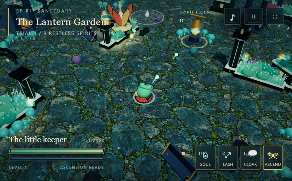

# Spirit Sanctuary: The Lantern Garden

A browser action roguelite about a little frog keeper restoring a ruined garden. Gather spirit, weave jade magic, choose upgrades, and release ancient wardens into living willows.

**[Play in your browser](https://ajeetpratapsingh12.github.io/spirit-sanctuary/)** · [Offline version](play-offline.html) · [Credits](ATTRIBUTION.md) · [AI disclosure](AI_DISCLOSURE.md)



## Run from this repository

Requires a current browser with WebGL. The development commands require Node.js 20 or newer. There are **no package dependencies**, no API keys, and no account needed to play.

```sh
git clone https://github.com/ajeetpratapsingh12/spirit-sanctuary.git
cd spirit-sanctuary
npm start
```

Open **http://127.0.0.1:5175/**. If that port is busy, use `npm start -- --port=5180`.

You can also run `python -m http.server 5175 --bind 127.0.0.1` from the repository root instead of using Node. To play completely offline, download **play-offline.html** using GitHub's download button and open the downloaded file in your browser. All game scripts, styles, and the painted texture are embedded in it; no fonts or other assets are fetched from external services.

## Build and check

```sh
npm run build
npm run check
npm run preview
```

The build creates a deployable static site in `dist/` and regenerates `play-offline.html`. Preview serves `dist/` at http://127.0.0.1:5175/. Neither building nor checking downloads packages. Checks cover JavaScript syntax, required assets, dependency packaging, attribution/license notices, and the submission-description length. They do not replace gameplay testing.

## Computer and phone

The arena fills its window and reframes for portrait or landscape. Desktop uses keyboard and mouse; touch input activates an on-screen joystick and ability buttons. A manual control selector is available in the pause settings.

| Action | Computer | Phone |
| --- | --- | --- |
| Move relative to the camera | WASD / arrows | Left joystick |
| Jade bolt | Auto-targeting; mouse / 1; F toggles auto | Auto-targeting |
| Arc lash | E / right mouse / 2 | Lash |
| Hop dash | Space / Shift / 3 | Hop |
| Spirit ascension | Q / 4 | Ascend |
| Rest at a bench / ring a bell | R when nearby | Interact button |
| Pause and settings | Esc / P or pause button | Pause button |
| Sound / music | M / B | Sound button / pause settings |
| Camera / zoom | V or C / mouse wheel | Automatic framing |

For a phone on the same Wi-Fi during development, run `npm run start:lan` and open `http://<computer-LAN-IP>:5175/` on the phone. This explicitly exposes the development server to the local network; allow it only on a trusted private network if your firewall prompts. The public play link requires no local server.

Auto graphics adapts the pixel budget and effects to performance. At a 1920 × 1080 desktop window it targets Full HD; other window shapes keep their own aspect ratio. Low, Balanced, High, reduced-motion and sound controls are in Pause. Mobile layouts were checked in a desktop browser; performance on every physical phone has not been verified.

## What this extension adds

- Responsive isometric framing and camera-relative computer/touch controls.
- Painted mossy slate, inked architecture, flowering beds, copper lotus sculptures, candlelit arches, lily cisterns, wind and fireflies.
- A leaf-hooded frog keeper with a red travelling cape and satchel.
- Animated segmented creatures, colorful spells, a compact ascended form and quiet synthesized creature voices.
- A cinematic boss entrance and boss-to-willow transformation that restores the garden.
- Upgrade drafts, interactive healing benches, resonance bells and breakable reliquaries.
- A compact HUD, creature-garden preview, rebirth preview and offline packaging.

The project was developed from a supplied browser prototype with AI assistance. The reference screenshots informed visual direction; their characters, logos, pixels and music are not distributed here. The models and effects are stylized procedural 3D artwork, not reproductions of the reference games' assets.

## Required attribution and licenses

This project is based on the JetBrains Academy course **Build a Game With an AI Coding Agent** and the course project at https://github.com/jetbrains-academy/game-course.

**Copyright (c) 2025 JetBrains Academy. Licensed under the MIT License.** The original notice and license are retained in [LICENSE](LICENSE) and [NOTICE](NOTICE). This is a participant extension, not an official JetBrains product or endorsement.

[ATTRIBUTION.md](ATTRIBUTION.md) records project provenance. [ASSETS.md](ASSETS.md) lists software/assets with their sources and license terms. [AI_DISCLOSURE.md](AI_DISCLOSURE.md) explains the AI tools and their contributions. Third-party license files are included alongside the bundled software.

## Hosting

This is a static site. On GitHub Pages, select **Settings → Pages → Deploy from a branch → main → /(root)**. The root already contains the complete playable site and `.nojekyll`; no Actions workflow or secret is required. The same files can be hosted on any static HTTPS host.

## Challenge submission

[SUBMISSION.md](SUBMISSION.md) contains the title, links and a description under 500 characters. [RULES-CHECKLIST.md](RULES-CHECKLIST.md) maps the supplied requirements to repository files and the remaining participant actions. The participant must provide the genuine course certificate and final gameplay media, review the organizer's current rules, and personally accept the submission terms. Repository contents alone do not establish eligibility.

Keep the repository **public until at least October 30, 2026**, as required by the supplied challenge instructions. The organizer's [announcement](https://blog.jetbrains.com/education/2026/10/12/build-your-game-challenge-join-in-and-compete-for-prizes/) directs entrants to Discord for the full rules.
